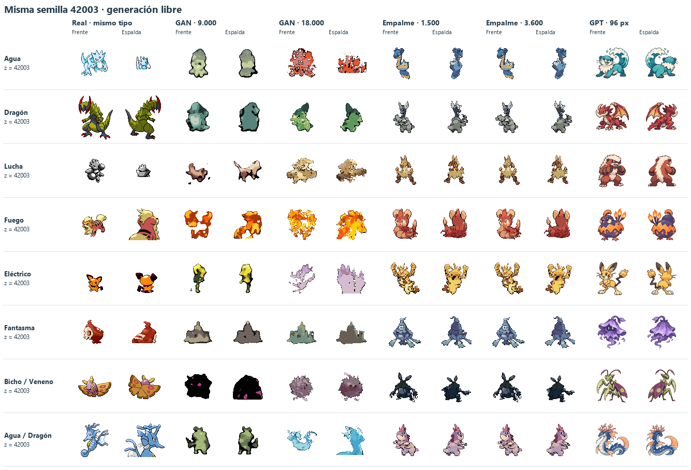

# Laboratorio de sprites

Elige uno o dos tipos y pulsa **Generar criatura**. Cada clic sortea una semilla y muestra dos vistas descargables de 96 × 96 píxeles. Marca **Fijar semilla para comparar** si quieres recuperar una criatura o cambiar de modelo con la misma semilla. Escribir una semilla o seleccionar una criatura del historial también la fija. Para recuperar el ejemplar espectral de la sesión, elige Trazo, Fantasma y Psíquico y escribe 318071.



## Abrir en Linux

En Linux x86-64 con Python 3.10 a 3.13 y el módulo venv instalado:

```bash
git clone --depth 1 https://github.com/salvachu/lab3_G.git
cd lab3_G
python3 -m venv .venv
source .venv/bin/activate
python -m pip install "torch==2.7.1" --index-url https://download.pytorch.org/whl/cpu
python -m pip install numpy pillow
python interfaz.py --cpu
```

Abre [la interfaz local](http://127.0.0.1:7860) y mantén la terminal abierta. Para salir, pulsa Ctrl+C. Para abrirla otro día, desde la carpeta del proyecto ejecuta `.venv/bin/python interfaz.py --cpu`. En Debian o Ubuntu, si falta venv, el paquete se llama `python3-venv`.

## Modelos

**Empalme · unión ajustada** conserva las dos especies elegidas por la versión de 1.500 pasos para cada semilla. Desplaza y ajusta el ancho del torso donde se encuentran los dos dibujos. Busca un camino de corte que respete los contornos y las marcas de pigmento, y ajusta los tonos cercanos a la unión. El retocador adversarial llegó a 3.600 pasos con ejemplos de cortes curvos, desplazamientos y cambios de tono. Se puede comparar en el selector con el Empalme original. [Comparación ampliada de las uniones](estructura/continuacion/union.png) · [Cuatro semillas](estructura/continuacion/empalme_despues.png)

**GAN jerárquica · 18.000 pasos** continúa el checkpoint de 12.500 pasos del mismo generador. El entrenamiento añade una pérdida de silueta y pigmento sobre mezclas de dos especies próximas en su representación interna. Al generar, el muestreo da más peso a los grupos y variaciones asociados a los tipos solicitados. El generador sigue dibujando ambos lados desde una semilla. [Cuatro semillas](estructura/continuacion/gan_despues.png) · [Progresión por pasos](estructura/continuacion/progresion.png) · [Reconstrucción de especies de validación](estructura/continuacion/reconstruccion.json) · [Medidas de generación libre](estructura/continuacion/resultados.json)

En cuatro semillas de reserva y ocho condiciones, Empalme redujo del 9,2 % al 4,6 % la proporción de posiciones en la unión donde la figura se interrumpe entre dos filas. Mejoraron 22 de 32 pares según esa medida. En la GAN, la reconstrucción media de siluetas mejoró del 88,4 % al 91,5 % de solapamiento en 102 especies de validación. En generación libre, 30 de 32 pares de la GAN nueva quedaron por debajo del percentil 5 de distancia de validación a entrenamiento, frente a 21 de 32 del control. Esto indica un mayor parecido a los cuerpos de entrenamiento según esa distancia de color y silueta. [Ejemplos más cercanos](estructura/continuacion/parecidos_train.png) · [Primeros nueve tipos](estructura/continuacion/tipos_1.png) · [Otros nueve tipos](estructura/continuacion/tipos_2.png)

**GAN jerárquica** recibe una semilla y uno o dos tipos. Un generador convolucional dibuja ambos lados con una paleta común. Se entrenó desde cero con reconstrucción, un discriminador condicional y ruido a tres escalas. Para muestrear se ajustaron 256 grupos sobre representaciones del conjunto de entrenamiento. Cada centro combina seis especies distintas. La red genera los píxeles en la interfaz. Las siluetas cambian entre semillas, aunque a varias criaturas les faltan ojos legibles o un rasgo que identifique su tipo.

**Empalme** reutiliza regiones de dos especies distintas del conjunto de entrenamiento. Alinea las regiones en ambas vistas y comparte los colores entre frente y espalda. Una red entrenada durante 1.500 pasos con reconstrucción y un discriminador retoca la unión. Este procedimiento conserva más detalles originales y a veces deja a la vista la especie que aportó la cabeza o el cuerpo. La lámina de procedencia muestra los dos sprites que contribuyeron a cada ejemplo.

[Cuatro semillas de la GAN](estructura/empalme/jerarquica.png) · [Cuatro semillas de Empalme](estructura/empalme/semillas.png) · [Especies de origen de Empalme](estructura/empalme/origen.png) · [Pares más parecidos a los de entrenamiento](estructura/empalme/parecidos_train.png)

[Comparación con AEGAN y el experimento Mosaico](estructura/empalme/modelos.png) · [Primeros nueve tipos](estructura/empalme/tipos_1.png) · [Otros nueve tipos](estructura/empalme/tipos_2.png) · [Resultados de las comprobaciones](estructura/empalme/evaluacion.json)

El control anterior de la interfaz usa el paso **9.000** de la GAN jerárquica. En 102 especies apartadas, el ajuste hasta 12.500 mejoró el solapamiento medio al reconstruir siluetas del 88,4 % al 89,4 %. Al generar libremente con cuatro semillas fijadas antes de la comparación, perdió continuidad en algunos cuerpos, especialmente en Dragón. Se conservó el paso 9.000 por esa revisión visual. [Generación a 9.000 pasos](estructura/empalme/desarrollo_09000.png) · [Las mismas semillas a 12.500 pasos](estructura/empalme/desarrollo_12500.png) · [Medidas de reconstrucción](estructura/empalme/reconstruccion.json)

**Referencias visuales que queremos conservar.** Para Fantasma puro, Ficha con las semillas 96553, 121211 y 121212 produce el manto, el farol y la máscara. Para Dragón, Lucha y Bicho/Veneno, usa Perfiles · 64 grupos con 318071. Con esa misma semilla, Pigmentos · 24 paletas da el insecto de alas azules y Detalle · +1.200 da la versión de alas extendidas. Las tres versiones se pueden seleccionar en la interfaz. Cada checkpoint admite otras semillas.

[Tres fantasmas de Ficha](estructura/ficha/fantasma_con_gpt.png) · [Detalle, Perfiles y Pigmentos frente a sprites reales](estructura/perfiles_pareados/comparacion.png)

Para evaluar una candidata, comparar frente y espalda con estos ejemplos y con una misma tanda de semillas adicionales para cada tipo. Conservar la versión preferida por tipo cuando la candidata pierde un rasgo que se quería preservar. El comando `python verificar_referencias.py` comprueba que los checkpoints anteriores siguen reproduciendo los ejemplos de las láminas, con tolerancia a las diferencias entre CPU y CUDA.

**AEGAN condicional desde cero.** El experimento neuronal del laboratorio entrenó un generador que recibe 96 valores de ruido y uno o dos tipos y produce ambas vistas en seis canales. El discriminador de imágenes evalúa el par junto con sus tipos. El entrenamiento también utiliza un encoder y un crítico del espacio latente. Las muestras libres todavía muestran contornos imprecisos. Se incluyen los pesos del generador al paso 6.000 y la comparación de tres condiciones con seis semillas por condición. [Entrenamiento](train_aegan_pairs.py) · [Muestras del checkpoint](runs/aegan_control_6000/step_06000.png).

```bash
python sample_cycles.py pesos/aegan_6000.pth --types fire water+dragon bug+poison --seeds 96137 96553 97001 --output aegan.png
```

Para entrenar el control desde cero con el dataset preparado y CUDA, ejecuta `python train_aegan_pairs.py runs/aegan_repeticion --steps 6000 --batch 16` usando una carpeta de salida nueva.

**Ficha diversa** añade un generador de anatomía por flujo condicional, entrenado durante 2.600 pasos con 11.653 pares de sprites de 923 especies de la partición de entrenamiento. A partir de los tipos y el ruido muestrea conjuntamente una de ocho familias, el perfil de ambas vistas, proporciones, pigmento y un mapa de luminosidad para cada lado. El dibujo aún depende de las familias del laboratorio y usa el acabado adversarial de Ficha. Bicho/Veneno conserva los cuerpos de insecto. Agua/Dragón combina los cuerpos acuáticos con familias de Ficha. Fantasma puro alterna entre figuras espectrales y animales, y Fantasma/Psíquico usa el acabado de Trazo. Se muestran cuatro semillas consecutivas por tipo. El benchmark también mide ocho semillas independientes. La diferencia de silueta mide variación, no calidad artística.

[Comparar con reales y GPT](estructura/diversa/comparacion.png) · [Fantasma/Psíquico en cinco semillas](estructura/diversa/fantasma_psiquico.png) · [Medidas por tipo](estructura/diversa/medidas.json)

**Ficha**, seleccionado al abrir, usa las proporciones y colores medidos en sprites de entrenamiento. Para Fantasma puro incorpora mantos, faroles y máscaras. **Cuerpos** es un experimento con nuevos planes corporales para los otros 17 tipos y combinaciones de tipos. Se partió de Ficha a 1.200 pasos y se entrenó el acabado hasta los 2.000. Los planes se comparten entre tipos compatibles. La semilla, el tipo y la ficha determinan qué se dibuja y qué rasgos comparten ambas vistas.

Ficha y Cuerpos son híbridos. El código dibuja la anatomía inicial y el perfil aprendido ajusta la silueta. El acabado neuronal se entrena contra un discriminador condicionado por tipo y ficha y actúa sobre el color dentro de la figura.

**Trazo** parte de Cuerpos. Su red adicional predice color y máscara para ambas vistas a 96 px, condicionada por tipos y entrenada con 800 pasos de reconstrucción y aprendizaje adversarial. Puede cambiar el borde del boceto. En los sprites de especies apartadas mejoró el solapamiento de silueta tras deteriorar las imágenes de los 18 tipos. Esta prueba mide restauración. Para juzgar la generación libre se incluyen seis semillas fijas por condición y los checkpoints se pueden comparar desde la interfaz. Los pesos de los modelos de la interfaz están incluidos en `pesos/`.

[Comparación de ocho tipos](estructura/trazo/comparacion.png) · [Insecto hoja](estructura/trazo/insecto_hoja.png) · [Seis primeros tipos](estructura/trazo/tipos_1.png) · [Seis siguientes](estructura/trazo/tipos_2.png) · [Seis últimos](estructura/trazo/tipos_3.png) · [Medidas por tipo](estructura/trazo/validacion.csv)

La columna GPT sirve de referencia de diseño. Se creó a partir de descripciones más detalladas y se convirtió a dos lienzos de 96 px con un máximo de 15 colores de figura compartidos y fondo blanco. El dibujo ocupa hasta 64 px en el lado largo para aproximar la escala de las criaturas del laboratorio. Los modelos locales reciben tipos y semilla.

## Muestreo por terminal

```bash
python sample_cycles.py pesos/ficha_todos.pth --types bug+poison water+dragon --seeds 96553 121211 121212 --output muestras.png
```

## Entrenamiento

Para continuar en un equipo con PyTorch y CUDA, coloca los originales `pairs.csv` e `images96.zip` en `dataset/`. Desde la raíz del proyecto ejecuta estos comandos.

```bash
python prepare.py
python train_ficha.py --run runs/ficha_todos --steps 2200
```

El checkpoint de entrenamiento conserva los optimizadores y el discriminador. La preparación verifica los datos y la partición por especie antes de retomar.

Para entrenar o reanudar el generador de anatomía con la colección preparada y las asignaciones de familia de TRAIN incluidas, ejecuta `python train_diversa.py --steps 2600`. Guarda el estado en `runs/diversa/checkpoint.pt` y exporta los pesos de inferencia a `pesos/diversa.pth`. Para repetir sus láminas usa `python evaluar_diversa.py`.

Para repetir la GAN jerárquica y Empalme con la colección preparada, ejecuta lo siguiente. El entrenamiento guarda el estado para reanudar en la misma carpeta.

```bash
python train_jerarquica.py --steps 9000
python ajustar_prior_jerarquico.py --output pesos/jerarquica.pth
python train_empalme.py --steps 1500
cp runs/empalme_color/modelo_01500.pth pesos/empalme.pth
python evaluar_empalme.py
```

Para reproducir la continuación a partir de esos dos checkpoints completos, ejecuta los siguientes comandos. La evaluación necesita el dataset preparado y CUDA para buscar los vecinos de entrenamiento.

```bash
python train_jerarquica.py --steps 18000
python ajustar_prior_jerarquico.py --metodo typed_convex --ema --output pesos/jerarquica_nueva.pth
mkdir -p runs/empalme_union_final
cp -n runs/empalme_color/checkpoint.pt runs/empalme_union_final/checkpoint.pt
python train_empalme.py --union --run runs/empalme_union_final --steps 3600
cp runs/empalme_union_final/modelo_03600.pth pesos/empalme_union.pth
python evaluar_continuacion.py --gan pesos/jerarquica_nueva.pth --empalme pesos/empalme_union.pth
```
