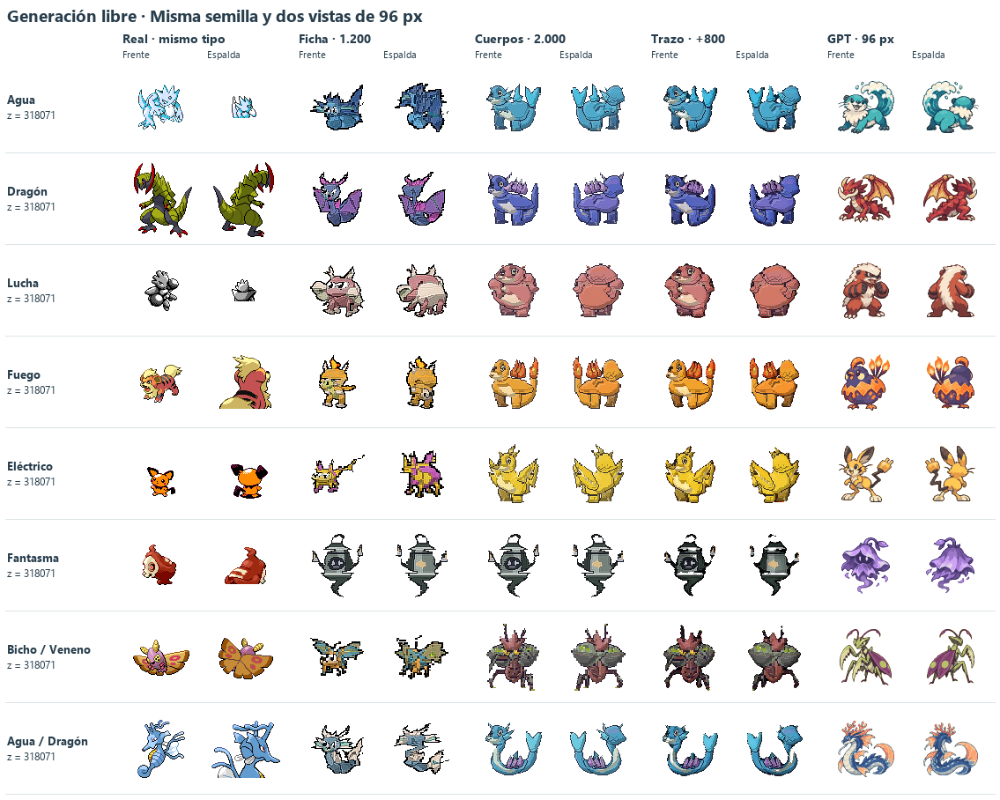

# Laboratorio de sprites

Elige uno o dos tipos y una semilla. La interfaz genera una criatura en dos vistas de 96 × 96 píxeles y permite descargar cada PNG. Cambiar la semilla produce otra muestra. Cambiar el modelo conservando los controles permite compararlos.



## Abrir en Linux

En Linux x86-64 con Python 3.10 a 3.13 y el módulo venv instalado:

```bash
git clone --depth 1 https://github.com/salvachu/lab3_G.git
cd lab3_G
python3 -m venv .venv
source .venv/bin/activate
python -m pip install "torch==2.7.1" --index-url https://download.pytorch.org/whl/cpu
python -m pip install numpy pillow
python interfaz.py --cpu
```

Abre [la interfaz local](http://127.0.0.1:7860) y mantén la terminal abierta. Para salir, pulsa Ctrl+C. Para abrirla otro día, desde la carpeta del proyecto ejecuta `.venv/bin/python interfaz.py --cpu`. En Debian o Ubuntu, si falta venv, el paquete se llama `python3-venv`.

## Modelos

**Ficha**, seleccionado al abrir, usa las proporciones y colores medidos en sprites de entrenamiento. Para Fantasma puro incorpora mantos, faroles y máscaras. **Cuerpos** es un experimento con nuevos planes corporales para los otros 17 tipos y combinaciones de tipos. Se partió de Ficha a 1.200 pasos y se entrenó el acabado hasta los 2.000. Los planes se comparten entre tipos compatibles. La semilla, el tipo y la ficha determinan qué se dibuja y qué rasgos comparten ambas vistas.

Ficha y Cuerpos son híbridos. El código dibuja la anatomía inicial y el perfil aprendido ajusta la silueta. El acabado neuronal se entrena contra un discriminador condicionado por tipo y ficha y actúa sobre el color dentro de la figura.

**Trazo** parte de Cuerpos. Su red adicional predice color y máscara para ambas vistas a 96 px, condicionada por tipos y entrenada con 800 pasos de reconstrucción y aprendizaje adversarial. Puede cambiar el borde del boceto. En los sprites de especies apartadas mejoró el solapamiento de silueta tras deteriorar las imágenes de los 18 tipos. Esta prueba mide restauración. Para juzgar la generación libre se incluyen seis semillas fijas por condición y los checkpoints se pueden comparar desde la interfaz. Los pesos de las tres variantes están incluidos en `pesos/`.

[Comparación de ocho tipos](estructura/trazo/comparacion.png) · [Insecto hoja](estructura/trazo/insecto_hoja.png) · [Seis primeros tipos](estructura/trazo/tipos_1.png) · [Seis siguientes](estructura/trazo/tipos_2.png) · [Seis últimos](estructura/trazo/tipos_3.png) · [Medidas por tipo](estructura/trazo/validacion.csv)

La columna GPT sirve de referencia de diseño. Se creó a partir de descripciones más detalladas y se convirtió a dos lienzos de 96 px con un máximo de 15 colores de figura compartidos y fondo blanco. El dibujo ocupa hasta 64 px en el lado largo para aproximar la escala de las criaturas del laboratorio. Los modelos locales reciben tipos y semilla.

## Muestreo por terminal

```bash
python sample_cycles.py pesos/ficha_todos.pth --types bug+poison water+dragon --seeds 96553 121211 121212 --output muestras.png
```

## Entrenamiento

La colección del profesor se usa solo para entrenamiento y evaluación. Para continuar en un equipo con PyTorch y CUDA, coloca los originales `pairs.csv` e `images96.zip` en `dataset/`. Desde la raíz del proyecto:

```bash
python prepare.py
python train_ficha.py --run runs/ficha_todos --steps 2200
```

El checkpoint de entrenamiento conserva los optimizadores y el discriminador. La preparación verifica los datos y la partición por especie antes de retomar.
